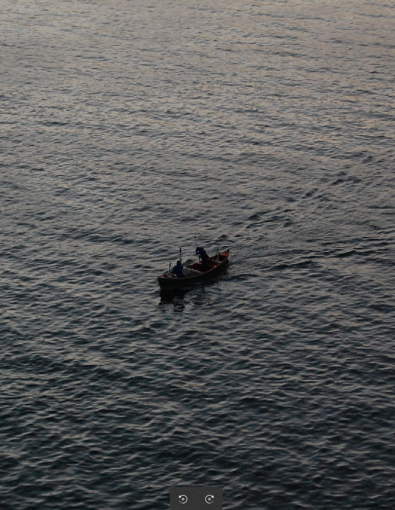

<h2>Victor Lacerda</h2>

Systems Analysis and Development student at IFSC and Junior Analyst at Veolia. Interested in software development, networking, and practical solutions to real-world problems.

<h3>Areas of Interest</h3>

- Web development
- Networking
- Databases
- Automation and scripting
- Technical support and infrastructure

<h3>Technologies</h3>

- **Languages:** Java, React, Python, JavaScript
- **Databases:** PostgreSQL
- **Networking:** TCP/IP, enterprise networks, RouterBOARD, VPN, support and configuration
- **Tools:** Git, VS Code, Linux

<h3>Contact</h3>

- LinkedIn: [Victor Lacerda](https://www.linkedin.com/in/victorlcrd/)
- Email: lacerd74@gmail.com
